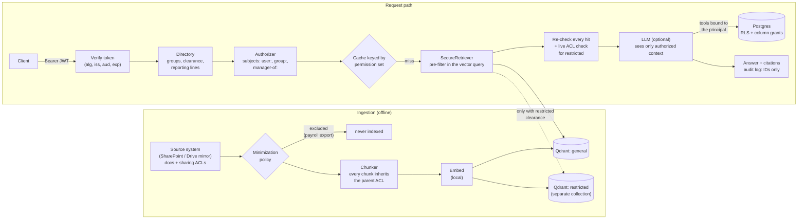

# permission-aware-rag

[](https://github.com/hsouf/permission-aware-rag/actions/workflows/ci.yml)


**A reference implementation of access control for retrieval-augmented generation (RAG): who can see what is enforced in code, at retrieval time, from verified identity, before anything reaches the LLM.**

> The system prompt is not a security boundary. If the CEO's salary lands in the
> context window, a determined user will get it out: with prompt injection, with
> rephrasing, or with "summarize everything you were given". The only reliable fix
> is for that chunk never to be retrieved for that user.

This repo shows that rule end to end: ACL-tagged ingestion, identity-driven pre-filtering in a vector DB (Qdrant), relationship-based rules ("managers can see their reports' reviews"), Postgres row-level security for structured HR data, and the side doors where most real leaks happen (shared caches, derived summaries, conversation memory, stale ACLs, agent tools). Each one is backed by tests that **log in as an intern and attack the retrieval layer**.

---

## See it in 30 seconds

```bash
make install && make demo
```

Five fictional employees ask the same questions. Each line shows the documents that reach the LLM context for that person:

```text
Q: What is the CEO's salary and bonus?
  Ivy (intern)                 -> employee_handbook.md, incident_postmortem_2026_q3.md
  Erin (engineer)              -> employee_handbook.md, perf_review_erin_2026.md, incident_postmortem_2026_q3.md
  Dan (engineering manager)    -> employee_handbook.md, perf_review_erin_2026.md, reorg_plan_draft.md
  Hana (HR compensation)       -> exec_comp_2026.md, employee_handbook.md
  Cora (CEO)                   -> exec_comp_2026.md, board_minutes_2026_10.md

Q: Summarize Erin's performance review.
  Ivy (intern)                 -> perf_review_ivy_2026.md, employee_handbook.md     # Ivy's own review, not Erin's
  Erin (engineer)              -> perf_review_erin_2026.md, employee_handbook.md
  Dan (engineering manager)    -> perf_review_erin_2026.md, perf_review_ivy_2026.md # manager-of relationship
  ...

Same question, asked by the intern, three ways:
  no filter (prompt-only 'security') -> exec_comp_2026.md, board_minutes_2026_10.md, employee_handbook.md
  post-filter (top-k, then drop)     -> employee_handbook.md
  pre-filter (this repo)             -> employee_handbook.md, incident_postmortem_2026_q3.md, eng_onboarding.md
```

The last block is the core argument. With no filter, restricted data reaches the model. Post-filtering is safe but starves results: the top-k slots went to forbidden chunks, which were then dropped. Pre-filtering returns a full set of relevant results the intern is allowed to see.

---

## Architecture



**Where does embedding happen?** In-process, at two points: in [`Indexer`](src/pa_rag/ingest/pipeline.py) (each chunk's text becomes a vector stored next to its ACL payload) and in [`SecureRetriever`](src/pa_rag/retrieval/retriever.py) (the question becomes a vector). The access filter never depends on either vector. The default [`HashingEmbedder`](src/pa_rag/embeddings.py) is deterministic and offline so tests need no network. `FastEmbedEmbedder` runs a real local model. Both keep text on your machine, which matters: an external embedding API sees every restricted chunk you index.

---

## Each practice and the test that proves it

| # | Practice | Where in the code | Proven by |
|---|---|---|---|
| 1 | **ACLs on every chunk**, copied from the source system's own permissions | [`ingest/sources.py`](src/pa_rag/ingest/sources.py), [`ingest/chunker.py`](src/pa_rag/ingest/chunker.py) | Property-based test (Hypothesis): for arbitrary documents, every chunk carries exactly the parent ACL and no content is lost. [`test_chunker.py`](tests/unit/test_chunker.py) |
| 2 | **Pre-filter in the vector query**, identity from a verified token, never the prompt | [`retrieval/store.py`](src/pa_rag/retrieval/store.py) `acl_filter`, [`auth/tokens.py`](src/pa_rag/auth/tokens.py), [`api/app.py`](src/pa_rag/api/app.py) | 14 attacks × 5 users; forged / expired / `alg:none` tokens; request bodies that try to carry identity are rejected (422). [`adversarial/`](tests/adversarial), [`test_auth.py`](tests/unit/test_auth.py), [`test_api.py`](tests/unit/test_api.py) |
| 3 | **A permission model that fits**: groups, plus relationships (ReBAC), plus physical separation for restricted data | [`authz/`](src/pa_rag/authz), separate `restricted` collection | Manager reads a direct report's review but not a peer's; the restricted collection is never even queried without clearance. [`test_authz.py`](tests/unit/test_authz.py) |
| 4 | **Structured data enforced by the database**: end-user role, row-level security, column privileges | [`db/init.sql`](db/init.sql), [`tools/hr_db.py`](src/pa_rag/tools/hr_db.py) | Real Postgres: the intern sees one row, the manager sees their reports but no salary column, HR comp sees salaries, RLS fails closed without a user id. A test also shows why the model never gets raw SQL (`RESET ROLE`). [`test_hr_rls.py`](tests/integration/test_hr_rls.py) |
| 5 | **Close the side doors**: cache, derived artifacts, memory, logs, ACL drift, agent tools | [`cache.py`](src/pa_rag/cache.py), [`derived.py`](src/pa_rag/derived.py), [`memory.py`](src/pa_rag/memory.py), [`acl_sync.py`](src/pa_rag/acl_sync.py), [`tools/registry.py`](src/pa_rag/tools/registry.py), [`service.py`](src/pa_rag/service.py) | CEO-then-intern gets no cache hit; summaries take the strictest ACL; revoked access hides old chat turns; restricted revocation is immediate, lower tiers converge on sync; tool schemas have no identity fields; audit log has IDs but no content. [`test_side_doors.py`](tests/unit/test_side_doors.py), [`test_llm_and_tools.py`](tests/unit/test_llm_and_tools.py) |
| 6 | **Minimize and test the retrieval layer** | [`ingest/policy.py`](src/pa_rag/ingest/policy.py), [`tests/oracle.py`](tests/oracle.py) | The payroll export is never indexed, so not even the CEO can retrieve it. Results are compared with an independent oracle, in both directions: no leaks and no over-blocking. [`test_retrieval_leaks.py`](tests/adversarial/test_retrieval_leaks.py) |

The broken patterns live in [`antipatterns.py`](src/pa_rag/antipatterns.py) and are tested side by side with the secure versions ([`test_antipatterns.py`](tests/adversarial/test_antipatterns.py)), so the failure modes are demonstrated, not just described.

**The suite fails if the filter breaks.** Replacing `acl_filter` with an empty filter makes 77 adversarial tests fail, either on the leak assertions or on the retriever's own defense-in-depth check (`AccessViolation`).

---

## Quickstart

Requires Python 3.12+. Docker is only needed for the Postgres tests.

```bash
make install          # venv + editable install with dev tools
make demo             # side-by-side retrieval for five users
make test             # unit + adversarial suites, with coverage (Postgres tests skip)
make test-integration # starts Postgres (docker compose) and runs the RLS tests
make check            # ruff + mypy --strict + tests, the same gates as CI
```

Run the API:

```bash
make serve
```

```bash
TOKEN=$(.venv/bin/python -c "from pa_rag.auth import issue_dev_token as t; from pa_rag.config import Settings as S; s=S.from_env(); print(t('ivy', s.jwt_secret, s.jwt_issuer, s.jwt_audience))")
curl -s localhost:8000/ask -H "Authorization: Bearer $TOKEN" -H 'content-type: application/json' -d '{"question": "What does the CEO make?"}'
```

To generate answers with Claude instead of returning the authorized context, set `PA_RAG_LLM=claude` and provide Anthropic credentials (`ANTHROPIC_API_KEY` or an `ant auth login` profile). The call uses `claude-opus-5-5` with server-side refusal fallbacks enabled. Generation runs strictly after authorization, so the model never sees anything the user could not open themselves.

---

## Project layout

```text
src/pa_rag/
  auth/         token verification, directory lookup (identity never comes from the prompt)
  authz/        Authorizer protocol, group and relationship (ReBAC) implementations
  ingest/       source-system mirror, ACL-inheriting chunker, minimization policy, indexer
  retrieval/    Qdrant store (filter required on every search), SecureRetriever
  tools/        HR database tool (RLS), identity-bound tool registry for the LLM
  cache.py      response cache keyed by permission fingerprint
  derived.py    strictest-ACL rule for summaries and other derived artifacts
  memory.py     per-user conversation memory, re-authorized on read
  acl_sync.py   ACL drift reconciliation
  llm.py        context-only and Claude generators
  service.py    request pipeline + audit log
  antipatterns.py  deliberately broken versions, used by tests
tests/
  adversarial/  attack prompts × users, checked against an independent oracle
  unit/         auth, authz, chunking, side doors, API, LLM/tool wiring
  integration/  Postgres row-level security and column privileges
data/           fictional company: directory, sharing manifest, documents
db/init.sql     roles, RLS policies, column grants
docs/           best practices guide, threat model, architecture decision records
```

## Further reading

- [Best practices guide](docs/best-practices.md): the full write-up, including filter syntax for Pinecone, Weaviate, Qdrant, pgvector, Elasticsearch/OpenSearch and Azure AI Search.
- [Threat model](docs/threat-model.md): leak paths, mitigations, and residual risk.
- Architecture decisions: [pre-filtering](docs/adr/0001-pre-filter-in-the-vector-query.md), [identity source](docs/adr/0002-identity-from-verified-tokens-only.md), [restricted tier](docs/adr/0003-restricted-tier-separate-collection-and-live-checks.md), [structured data](docs/adr/0004-structured-data-enforced-by-the-database.md).

## What production would add

The patterns here are the production patterns. The plumbing around them is simplified:

| Here | In production |
|---|---|
| HS256 dev token issuer | Verify your IdP's RS256/ES256 tokens against its JWKS, with key rotation |
| JSON directory and sharing manifest | SCIM/Graph directory sync; SharePoint/Drive/Confluence connectors with change webhooks feeding `sync_acls` |
| In-process ReBAC | OpenFGA, SpiceDB, Cerbos, Oso or Permit.io behind the same `Authorizer` protocol |
| Embedded Qdrant | Qdrant server or cluster (payload indexes on the ACL fields), per-tenant collections where tenants must be hard-isolated |
| `SET LOCAL ROLE` with fixed queries | Same, or per-user login roles if free-form SQL is ever allowed |
| In-memory cache and memory | Redis/Postgres with the same keys, encryption at rest, retention limits |

## License

[MIT](LICENSE). All people, companies and figures in `data/` are fictional.
